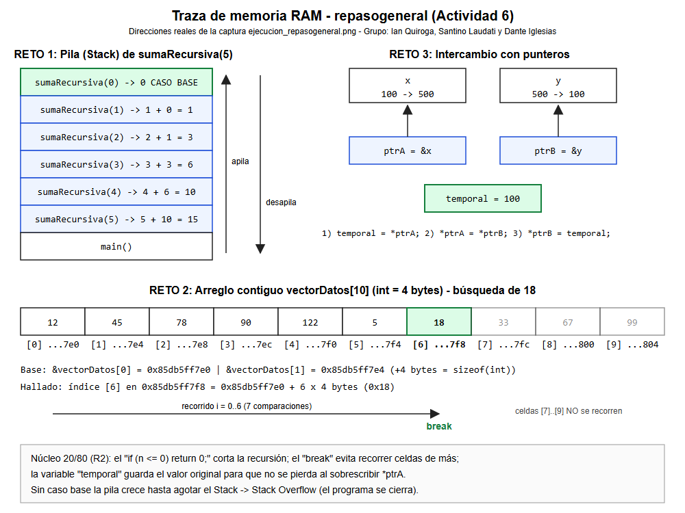
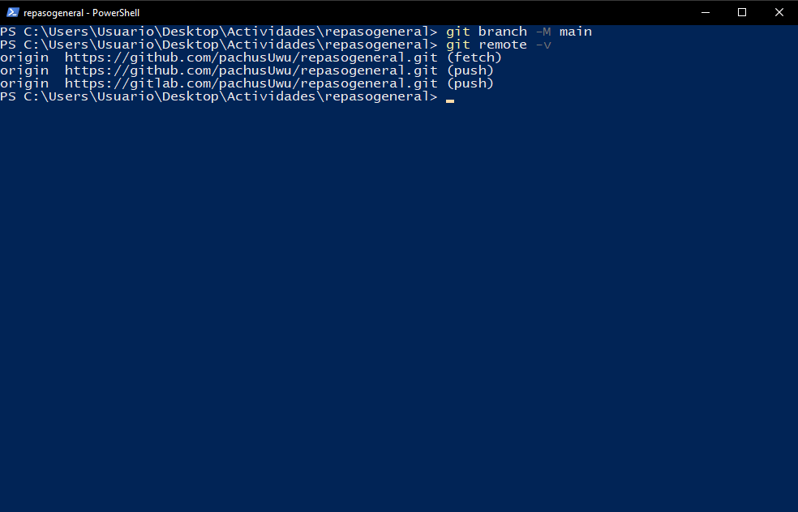

# 1. Propósito del documento

Este manual técnico describe la arquitectura de la suite **repasogeneral**, sus funciones, el modelo de memoria de cada reto, el procedimiento de compilación y la configuración del repositorio Dual-Remote (GitHub + GitLab).

# 2. Requisitos

| Herramienta | Versión |
|---|---|
| g++ (MSYS2 UCRT64) | 16.1.0 o superior |
| Visual Studio Code | Con extensión C/C++ |
| Git | 2.x con remotos GitHub y GitLab |

# 3. Estructura del repositorio

```
repasogeneral/
├── .gitignore  ├── .gitattributes  ├── LICENSE  ├── README.md
├── docs/
│   ├── InformeEEST1_LPR2026_ACT06_G03_Informe_v1.0.0.pdf
│   ├── CHANGELOG.md
│   └── manuales/manual_programador_v1.0.0.pdf, manual_usuario_v1.0.0.pdf
├── src/main.cpp
└── capturas/ejecucion_repasogeneral.png, traza_memoria.png, git_remote_dual.png
```

# 4. Arquitectura

`main()` ejecuta los tres retos en secuencia. Los retos 1 y 3 delegan en funciones modulares declaradas con prototipo; el reto 2 se resuelve en línea dentro de `main()`.

| Reto | Componente | Técnica |
|---|---|---|
| 1 | `int sumaRecursiva(int n)` | Recursividad con caso base |
| 2 | Ciclo `for` sobre `vectorDatos[10]` | Búsqueda secuencial O(n) con `break` |
| 3 | `void intercambiarValores(int*, int*)` | Pasaje por dirección y desreferenciación |

# 5. Referencia de funciones

## 5.1 `int sumaRecursiva(int n)`

| Elemento | Detalle |
|---|---|
| Parámetro | `n`: límite superior de la suma |
| Retorno | 1 + 2 + … + n (0 si `n <= 0`) |
| Caso base | `if (n <= 0) return 0;` |
| Profundidad de pila | n + 1 llamadas |

> Para valores muy grandes de `n` (cientos de miles) la pila puede desbordarse. Para esos casos usar la fórmula n·(n+1)/2 o un ciclo.

## 5.2 Búsqueda secuencial (reto 2)

| Variable | Tipo | Valor |
|---|---|---|
| `TAM` | `const int` | 10 |
| `vectorDatos` | `int[10]` | {12, 45, 78, 90, 122, 5, 18, 33, 67, 99} |
| `numeroBuscar` | `int` | 18 |
| `hallado` | `bool` | Bandera de resultado |

Recorre los índices 0..TAM-1; al encontrar el valor imprime índice y dirección, marca `hallado = true` y ejecuta `break`.

## 5.3 `void intercambiarValores(int* ptrA, int* ptrB)`

```cpp
int temporal = *ptrA;   // 1. resguardar A
*ptrA = *ptrB;          // 2. A <- B
*ptrB = temporal;       // 3. B <- A original
```

Precondición: ambos punteros deben ser válidos y distintos de `nullptr`.



# 6. Compilación

```powershell
g++ src/main.cpp -o src/repasogeneral.exe
.\src\repasogeneral.exe
```

# 7. Configuración Dual-Remote

```bash
git remote set-url origin https://github.com/pachusUwu/repasogeneral.git
git remote set-url --add --push origin https://github.com/pachusUwu/repasogeneral.git
git remote set-url --add --push origin https://gitlab.com/pachusUwu/repasogeneral.git
git remote -v      # 1 fetch + 2 push
git push -u origin main
```



# 8. Versionado

Se utiliza versionado semántico (MAJOR.MINOR.PATCH) y los cambios se registran en `docs/CHANGELOG.md`. Convención de commits: `feat:`, `fix:`, `docs:`, `chore:`.

# 9. Guía de mantenimiento

- Para buscar otro número, cambiar `numeroBuscar`; para pedirlo al usuario, reemplazar la asignación por `cin >> numeroBuscar;`.
- Si se agrega un reto nuevo, declararlo como función con prototipo y registrar el cambio en el CHANGELOG con un aumento de versión MINOR.
