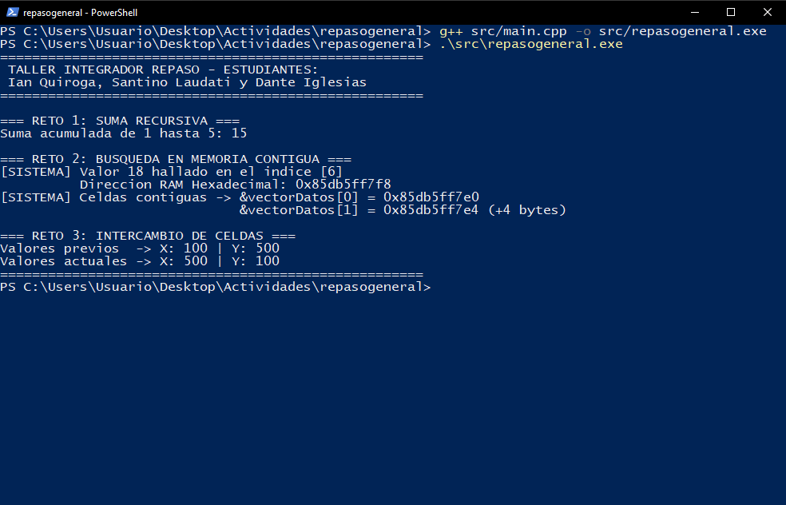

# 1. ¿Qué hace este programa?

**repasogeneral** es un programa de consola que muestra, en una sola ejecución, tres demostraciones de programación en C++:

1. **Suma recursiva:** suma los números del 1 al 5 usando una función que se llama a sí misma.
2. **Búsqueda en memoria:** busca el número 18 dentro de una lista de 10 números y muestra en qué posición y en qué dirección de memoria lo encontró.
3. **Intercambio de valores:** intercambia los valores de dos variables (100 y 500) usando punteros.

No requiere que el usuario ingrese datos.

# 2. Requisitos

- PC con Windows 10 u 11.
- Compilador g++ instalado (MSYS2) o acceso a OnlineGDB.

# 3. Cómo ejecutarlo

1. Abrir la carpeta `repasogeneral` en Visual Studio Code.
2. Abrir la terminal con **Ctrl + Ñ**.
3. Compilar:

```powershell
g++ src/main.cpp -o src/repasogeneral.exe
```

4. Ejecutar:

```powershell
.\src\repasogeneral.exe
```

# 4. Cómo leer los resultados



| Sección | Qué significa |
|---|---|
| RETO 1 | "Suma acumulada de 1 hasta 5: 15" → 1+2+3+4+5 = 15 |
| RETO 2 | Posición (índice) del 18 en la lista y su dirección de memoria. Las direcciones cambian en cada ejecución, es normal. |
| RETO 3 | Los valores de X e Y antes y después del intercambio |

# 5. Preguntas frecuentes

| Problema | Solución |
|---|---|
| "g++ no se reconoce como comando" | El compilador no está instalado o no está en el Path. Usar OnlineGDB. |
| La dirección de memoria es distinta a la del manual | Es correcto: Windows ubica la memoria en un lugar distinto en cada ejecución. |
| La ventana se cierra sola | Ejecutar el programa desde la terminal y no con doble clic. |

# 6. Soporte

Ante dudas, contactar al grupo G03: Ian Quiroga, Santino Laudati y Dante Iglesias.
